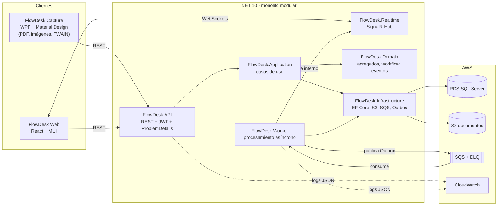
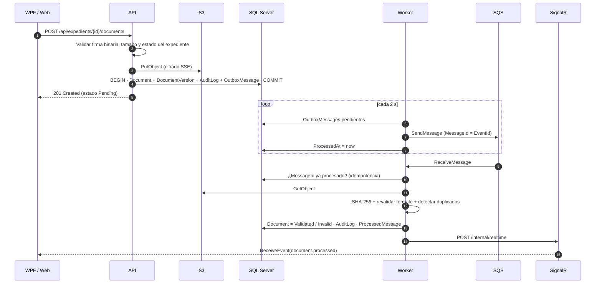

# Arquitectura de FlowDesk

## Vista de componentes



### Dependencias entre capas

```
API ──► Application ──► Domain
 │           ▲
 └──► Infrastructure ──┘        Worker ──► Infrastructure
Realtime ──► Application         Desktop ──► Shared (contratos)
```

- **Domain** no depende de nada: reglas puras y testeables.
- **Application** define puertos (`IAppDbContext`, `IFileStorage`, `IRealtimeNotifier`…) y orquesta los casos de uso.
- **Infrastructure** implementa los puertos. Cambiar de S3 a disco o de SQS a proceso es configuración, no código.

## Módulos de negocio

| Módulo | Responsabilidad | Código |
| --- | --- | --- |
| Identity | Usuarios, roles, permisos, JWT | `Domain/Identity`, `Application/Identity` |
| Expedients | Expedientes, asignación | `Domain/Expedients`, `Application/Expedients` |
| DocumentManagement | Documentos, versiones, procesamiento | `Domain/Documents`, `Application/Documents` |
| Workflow | Definiciones y transiciones | `Domain/Workflow` |
| Notifications | Notificaciones persistidas y en tiempo real | `Application/Notifications`, `Realtime` |
| Audit | Registro inalterable | `Domain/Audit`, `Infrastructure/Services/AuditWriter` |
| Reporting | Dashboard y consultas de auditoría | `Application/Reporting` |

## Carga de un documento (Outbox + procesamiento asíncrono)



Si el guardado en base falla después de subir a S3, la API elimina el objeto (compensación) para no
dejar archivos huérfanos. Si falla la publicación a SQS, el mensaje queda en el Outbox y se
reintenta. Si falla el procesamiento, SQS lo reentrega y, tras 5 intentos, lo mueve a la DLQ con una
alarma de CloudWatch.

## Motor de workflow

Las transiciones están en `WorkflowTransitions` (configurables sin recompilar). Cada transición
define estado de origen y destino, permiso requerido y si exige observación. El agregado
`Expedient.ApplyTransition` valida:

1. que el estado actual coincida con el origen;
2. que el usuario tenga el permiso de la transición (`DomainForbiddenException` → 403);
3. la observación obligatoria (→ 422);
4. las condiciones de negocio: documentos presentes, sin documentos en proceso ni inválidos para aprobar (→ 422).

Luego registra el historial, la aprobación (si venía de "Pendiente de aprobación"), la fecha de
cierre y el evento `ExpedientStatusChanged`. La API nunca expone un "cambiar estado" libre.

## Seguridad

- JWT con claims `perm` por permiso; una política de autorización por permiso en cada endpoint.
- El dominio vuelve a validar el permiso de cada transición: ocultar botones en React es solo UX.
- Contraseñas con PBKDF2-SHA256 (100 000 iteraciones, sal aleatoria, comparación en tiempo constante).
- Rate limiting en `/api/auth/login`, CORS restringido y archivos servidos solo con token (sin URLs públicas de S3).
- Validación de firma binaria ("magic number"), no solo de la extensión, compartida entre WPF, API y Worker.

## Escalabilidad

| Necesidad | Solución |
| --- | --- |
| Procesamiento pesado | Workers independientes que escalan horizontalmente según la edad del mensaje más antiguo en SQS |
| Archivos | S3 con versionado y transición a Glacier IR |
| Eventos duplicados | `ProcessedMessages` + deduplicación por `MessageId` (SQS FIFO opcional) |
| Pérdida de eventos | Outbox transaccional + DLQ |
| Conflictos de edición | `ConcurrencyStamp` como token de concurrencia (409 al cliente) |
| Tiempo real con varias instancias de la API | Backplane de SignalR (Redis o Azure SignalR) sin cambiar `IRealtimeNotifier` |
| Trazabilidad | Correlation id de extremo a extremo (cliente → API → Outbox → Worker → auditoría) |
